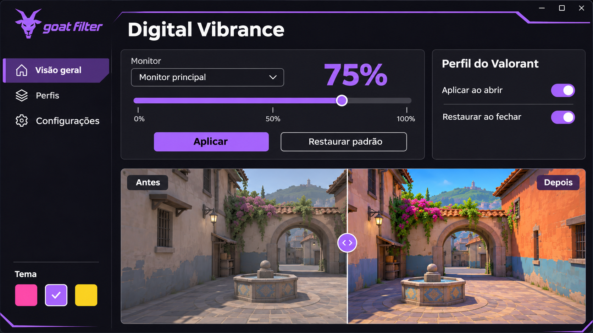

# Goat Filter

Utilitário para Windows que aumenta a intensidade das cores (**Digital Vibrance**) e
vai **além dos 100% do driver** com a camada **Super Vibrance**. Também ativa sozinho um
perfil quando o **Valorant** abre e devolve as cores quando o jogo fecha.



## Como funciona

| Faixa do slider | O que acontece |
|---|---|
| **0–100%** | Digital Vibrance do driver. NVIDIA via NVAPI e AMD via ADL. 50% = cores normais, 100% = máximo do painel. |
| **100–200%** | O driver fica em 100% e uma matriz de saturação do Windows soma por cima (até 2×). |
| **Intel / sem driver** | O slider inteiro usa a matriz do Windows (50% = normal). |

O Goat Filter **nunca toca no processo do jogo**: não injeta código, não usa overlay e
não lê memória. Só usa APIs do driver e do Windows, assim como o painel da NVIDIA ou da AMD.

Segurança das cores:
- Os valores originais ficam salvos em `session.json` antes de qualquer alteração. Se o app
  travar ou o PC desligar, eles são restaurados na próxima abertura.
- A camada Super pertence ao processo: se o app fechar, o Windows remove o efeito.
- Com "Restaurar cores ao sair", tudo volta ao original quando você sai pela bandeja.

> **Dica para o Valorant:** use o modo de exibição **"Janela em tela cheia"**. A camada
> Super (acima de 100%) passa pela composição do Windows e pode não aparecer em tela
> cheia exclusiva. A faixa de 0–100% (driver) funciona nos dois modos.

## Baixar o `.exe`

A cada push, o GitHub Actions compila no Windows e publica o artefato
**goat-filter-windows** (aba *Actions* → execução mais recente → *Artifacts*). Ele contém:

- `Goat Filter_0.1.0_x64-setup.exe`: o instalador
- `goat-filter.exe`: a versão portátil

O `.exe` ainda não tem assinatura digital, então o Windows SmartScreen pode avisar.
Clique em "Mais informações" → "Executar assim mesmo".

## Desenvolvimento

Pré-requisitos no Windows: [Node 22](https://nodejs.org), [Rust](https://rustup.rs) e
as Build Tools do Visual Studio (C++). O WebView2 já vem no Windows 10/11.

```bash
npm install
npm run tauri dev      # abre o app com recarregamento automático
npm run tauri build    # gera o instalador em target/release/bundle/nsis/
```

Só a interface, em qualquer sistema (modo demonstração, sem mexer nas cores):

```bash
npm run dev            # http://localhost:1420
```

Testes:

```bash
npm run typecheck && npm test   # interface (Vitest)
cargo test -p goat-core         # núcleo: camadas, sessão, detecção do jogo
```

## Estrutura

```
src/                 interface React + TypeScript (3 telas, 3 temas)
crates/goat-core/    núcleo em Rust, sem interface
  backends/nvapi.rs      NVIDIA Digital Vibrance
  backends/adl.rs        AMD saturação
  backends/magnifier.rs  camada Super (matriz de cor do Windows)
  engine.rs              junta as camadas e restaura os originais
  session.rs             recuperação após crash
  watcher.rs             detecta o jogo abrindo/fechando
src-tauri/           app Tauri: janela, bandeja, inicialização com o Windows
design/              kit visual (logos, mockups, especificação)
docs/PLANEJAMENTO.md planejamento completo
```
