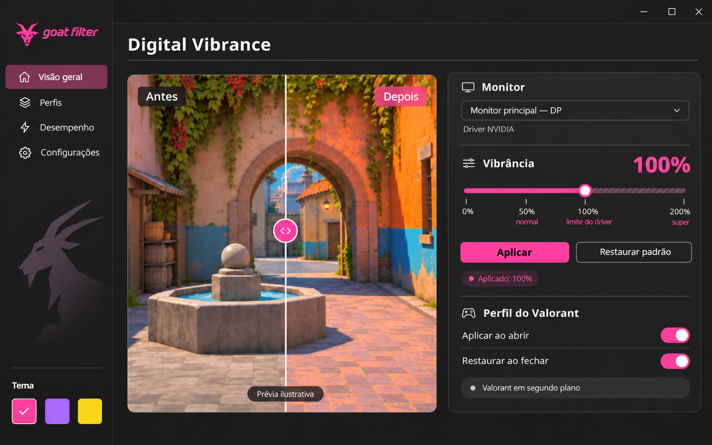

# Goat Filter

Utilitário para Windows que aumenta a intensidade das cores (**Digital Vibrance**) e
vai **além dos 100% do driver** com a camada **Super Vibrance**. Também ativa sozinho um
perfil quando o **Valorant** abre e devolve as cores quando o jogo fecha.



## Como funciona

| Faixa do slider | O que acontece |
|---|---|
| **0–100%** | Digital Vibrance do driver. NVIDIA via NVAPI e AMD via ADL. 50% = cores normais, 100% = máximo do painel. |
| **100–200%** | O driver fica em 100% e uma matriz de saturação do Windows soma por cima (até 2×). |
| **Intel / sem driver** | O slider inteiro usa a matriz do Windows (50% = normal). |

O Goat Filter **nunca toca no processo do jogo**: não injeta código, não usa overlay e
não lê memória. Só usa APIs do driver e do Windows, assim como o painel da NVIDIA ou da AMD.

Segurança das cores:
- Os valores originais ficam salvos em `session.json` antes de qualquer alteração. Se o app
  travar ou o PC desligar, eles são restaurados na próxima abertura.
- A camada Super pertence ao processo: se o app fechar, o Windows remove o efeito.
- Com "Restaurar cores ao sair", tudo volta ao original quando você sai pela bandeja.

### Dois métodos para passar de 100% (Configurações → Super Vibrance)

| Método | Onde funciona | Observação |
|---|---|---|
| **Matriz do Windows** (padrão) | Qualquer GPU, Windows 10 e 11 | Aplicada pela composição do Windows. No Valorant, use **"Janela em tela cheia"**. Some sozinha se o app fechar. |
| **Perfil de cor MHC2** (experimental) | Windows 11 | O app gera um perfil de cor com a matriz, e a própria GPU aplica: sem input lag e também em tela cheia exclusiva. É por monitor. Ao desligar, o perfil de cor anterior volta; se o app travar, ele é desfeito na próxima abertura. |

### Ajustes finos por perfil (Perfis → Ajustes finos)

| Ajuste | O que faz |
|---|---|
| **Realçar cor do inimigo** | Escolha vermelho, amarelo ou roxo, a mesma cor do contorno configurada no Valorant. Essa cor ganha saturação extra e as outras quase não mudam; o brilho é mantido. Usa a camada Super (qualquer método). |
| **Brilho / Contraste / Gama** | Curva de gama do Windows, por monitor. Gama acima de 1,00 clareia as sombras. |
| **Só com o jogo em foco** | No alt-tab, o Discord e o navegador voltam às cores normais; ao voltar para o jogo, o perfil é reaplicado. Não abre o processo do jogo: só compara a janela da frente com a lista de processos. |
| **Monitor (pelo cabo, DDC/CI)** | Brilho, contraste e (se o modelo aceitar) saturação do **próprio monitor**, como nos botões dele. Volta ao valor anterior quando o perfil sai. Se o monitor não responder, ligue a opção "DDC/CI" no menu dele. |
| **Testar agora** | Aplica o perfil no monitor padrão sem precisar abrir o jogo. **Restaurar padrão** volta tudo. |

Os perfis podem ser **exportados e importados** (arquivo `.goatfilter.json`) para compartilhar.

### Novidades da v1.4

- **Presets** no editor de perfis: Competitivo (cores fortes, contorno vermelho realçado e sombras
  mais claras), Vibrante e Natural.
- **Encontrar jogos instalados:** procura Valorant (Riot), Counter-Strike 2, Apex Legends, Overwatch 2,
  Rainbow Six Siege, PUBG e Rocket League na Steam, Fortnite e Rocket League na Epic, e cria os perfis
  com um clique.
- **Bandeja:** botão direito no ícone para ligar/desligar o filtro ou aplicar qualquer perfil.
- **Todos os monitores:** opção em Configurações › Monitor e ajustes.
- **Avisos do Windows** quando um perfil liga, pausa (alt-tab) ou desliga.
- **Inglês:** Configurações › Aparência › Idioma (Automático segue o idioma do Windows).

### Aba Desempenho

**Enquanto joga** (ligado quando o jogo abre, desfeito quando fecha ou no alt-tab):

| Ajuste | O que faz |
|---|---|
| Desligar aceleração do mouse | Desliga "Aprimorar precisão do ponteiro". Só na sessão: volta sozinho no próximo login se o app travar. |
| Teclado: repetição mais rápida | Atraso mínimo e velocidade máxima ao segurar uma tecla. |
| Plano de energia Alto desempenho | Evita a CPU reduzir a velocidade na partida. O plano original volta ao fechar o jogo (e após crash). |

**Teclas:** os atalhos do Goat Filter são configuráveis (sempre com Ctrl ou Alt). Eles **não**
mudam as teclas do jogo nem simulam teclas, o que mantém o app seguro contra ban.

| Atalho padrão | Ação |
|---|---|
| `Ctrl` + `Alt` + `G` | Liga/desliga o filtro |
| `Ctrl` + `Alt` + `↑` / `↓` | Sobe/desce 10% no monitor padrão |
| `Ctrl` + `Alt` + `P` | Aplica o próximo perfil |

**Checklist do sistema (v1.5):** mostra se o monitor está na taxa máxima (e coloca em 144 Hz, por
exemplo, com um clique), desliga a gravação em segundo plano do Xbox (Game DVR), liga o agendamento
de GPU por hardware (HAGS, pede permissão de administrador e vale após reiniciar) e abre a opção
"Não perturbe ao jogar" do Windows.

**Treino (v1.6):** aba nova, tudo rodando dentro do Goat Filter (fora do jogo):

- **Aquecer e jogar:** aquecimento de flick de 2, 3 ou 5 minutos e, no fim, abre o Valorant sozinho.
- **Mira:** treino de flick e tracking de 30 s, com precisão, tempo por alvo e recorde.
- **Reação:** tempo de reação (média de 5).
- **Mouse:** taxa de polling real (Hz) e teste de clique duplo do botão.
- **Sensibilidade:** converte entre Valorant, CS2, Apex e Overwatch 2, com eDPI e cm/360°.
- **Miras:** guarde códigos de mira do Valorant e copie com um clique.

**Gravação (v1.7):** replay instantâneo e gravação de gameplay, feitos para pesar pouco:

- **Replay instantâneo:** guarda os últimos segundos o tempo todo (por padrão só com o jogo aberto).
  Aperte `Alt` + `F8` (ou uma tecla sozinha, como `F8`, `Insert` ou do teclado numérico) e os últimos 30 s (ou 15, 20, 25, 35, 45, 60) viram um `.mp4`.
- **Gravar gameplay:** `Alt` + `F7` começa e para. Usa a mesma captura do replay.
- **Até 1440p (2K) a 60 fps**, com som do PC e microfone opcional. Clipes em `Vídeos\Goat Filter`.
- **Leve:** a tela é capturada pela própria GPU (Desktop Duplication) e codificada pelo chip de vídeo
  da placa (NVIDIA NVENC, AMD AMF ou Intel Quick Sync via Media Foundation), como o ShadowPlay. O
  vídeo fica em pedaços de 2 s; salvar um clipe só junta os pedaços, sem recodificar.
- Não toca no jogo: é a mesma captura da área de trabalho que o OBS usa.

**Clipes (v1.8):**

- **Botão lateral do mouse** (4 ou 5) como atalho de clipe, além de teclas sozinhas (F8, Insert, teclado numérico).
- **Editor:** assistir, cortar sem perder qualidade, renomear e pular para os **marcadores** (tecla "Marcar momento" durante a gravação).
- **Versões prontas:** vertical 1080×1920 (TikTok, Reels, Shorts) e comprimida para 10 MB (Discord) ou 25 MB.
- **Enviar para o Discord** por webhook do seu canal (comprime sozinho se passar de 10 MB).
- **Miniaturas, favoritos (★) e limpeza automática** por dias ou por tamanho da pasta (favoritos nunca são apagados).
- **Bipe ao salvar** e opção de **faixas de áudio separadas** (jogo e microfone) para editar depois.

**Desempenho+ (v1.9):**

- **Raio-X do PC:** nota de 0 a 100 com o que falta ajustar para jogar no máximo.
- **Reabrir apps** que o Goat Filter fechou quando o jogo abriu, assim que ele fecha.
- **Aviso de temperatura** da placa de vídeo durante o jogo (NVIDIA; 75–90 °C, no máximo 1 a cada 10 min).
- **Sua semana:** tempo jogado, partidas, clipes e temperatura máxima, com gráfico por dia.
- **Limpeza** de arquivos temporários e do cache de shaders antigo (só arquivos com mais de 1 dia; com o jogo fechado).

**Cores e treino (v1.10):**

- **Código de perfil** (`GF1-…`): copie a configuração de cor e mande para os amigos; eles colam e aplicam.
- **Modos novos de mira:** micro-flick, alvos que somem e peek (o alvo sai da borda como um inimigo), com tamanho de alvo.
- **Evolução:** sequência de dias treinando 🔥 e o melhor resultado de cada dia (14 dias).
- **Calculadora de DPI:** mede a contagem real do sensor com uma régua.
- **Teste de visibilidade:** silhuetas escondidas nas sombras, com as cores reais da tela.

**Conforto (v1.11):**

- **Boas-vindas** em 3 passos na primeira vez: cores no jogo, replay instantâneo e abrir com o Windows.
- **Voltar tudo ao normal:** desfaz cores, ajustes de mouse/teclado/energia e para a gravação.
- **Backup completo** das preferências em arquivo (perfis, atalhos, gravação, miras).
- **Bandeja:** "Salvar clipe agora" e ligar/desligar o replay sem abrir o app.
- **Fundo preto (OLED).**

**Miras prontas (v1.12):** 21 miras na aba Treino › Miras — de pros (TenZ, aspas, Demon1, Less,
cauanzin, mwzera…), estilos (ponto, cruz pequena…) e divertidas — com prévia desenhada a partir do
código, busca, filtro, copiar e salvar em "Minhas miras". Reunidas de sites de miras e de
configurações de pros; pros trocam de mira com frequência.

**Resolução esticada (v1.13):** em cada perfil, escolha uma resolução como 1280×960 (4:3). Quando o
jogo abre, o Windows muda para ela com a imagem esticada pela placa e volta ao normal quando o jogo
fecha (também se o PC desligar no meio, na próxima vez que o app abrir). Não mexe em arquivos do jogo:
no Valorant, use "Tela cheia em janela". Botão "Testar por 10 s" para conferir antes.

**Fechar ao abrir o jogo:** você marca apps pesados (navegadores, OneDrive, launchers…) e o Goat
Filter fecha esses apps quando o jogo abre, como se você clicasse no X (nunca à força, nunca o jogo).

**Painel da máquina:** uso de CPU e RAM e, em placas NVIDIA, uso, temperatura e VRAM da GPU.

**O que mais tira delay:** um checklist com o que realmente reduz atraso (NVIDIA Reflex,
buffer de entrada bruta, polling do mouse, FPS, Modo de Jogo do Windows).

### Log para diagnóstico

`%LOCALAPPDATA%\com.goatfilter.app\logs\goat-filter.log` registra o que foi detectado
(placa, monitores, métodos disponíveis) e cada ajuste aplicado.

## Roteiro de teste

1. Abra o app e vá em **Visão geral**. O seletor de monitor deve mostrar o nome do seu
   monitor e a etiqueta **Driver NVIDIA**.
2. Coloque **100%** e clique em **Aplicar**. O Painel da NVIDIA deve mostrar 100% de vibrance.
3. Coloque **150%** e clique em **Aplicar**. As cores devem ficar mais fortes do que em 100%.
4. Em **Configurações → Super Vibrance**, troque para **Perfil de cor MHC2**. Com 150%
   aplicado, as cores devem continuar fortes. Volte para 50% e confira se o normal voltou.
5. Abra o Valorant em **tela cheia** e em **janela em tela cheia** com cada método e veja
   onde a faixa acima de 100% aparece.
6. No jogo, teste `Ctrl+Alt+G` e `Ctrl+Alt+↑/↓`.
7. Em **Perfis → Ajustes finos**, escolha a cor do realce e suba a gama. Clique em
   **Testar agora** e depois em **Restaurar padrão** na Visão geral.
8. Em **Ajustes finos → Monitor (pelo cabo)**, veja quais controles o seu monitor aceita,
   marque **Brilho do monitor**, mude o valor e clique em **Testar agora**.
9. Ligue **Só com o jogo em foco**, abra o Valorant e dê alt-tab: o Windows deve voltar ao
   normal e o perfil deve voltar quando você retornar ao jogo.
10. Saia pela bandeja (**Sair**) e confira se as cores originais voltaram.

## Baixar

Baixe a versão mais recente na aba
[**Releases**](https://github.com/Fidelisss07/GOAT-FILTER-/releases/latest):

- `GoatFilter-<versão>-instalador.exe`: instala e cria atalho (recomendado)
- `GoatFilter-<versão>-portatil.exe`: roda sem instalar

**Atualização dentro do app** (versão instalada): quando sai versão nova, aparece um aviso no
topo do app com **Atualizar agora**: ele baixa (mostrando o progresso), confere o SHA-256 publicado
pelo GitHub, instala em silêncio e reabre sozinho. Se o app estiver só na bandeja e nenhum jogo
estiver aberto, isso acontece sem você fazer nada. Dá para desligar em Configurações › Sobre ›
**Atualizar sozinho**. A versão portátil só avisa e leva à página de download.

### Links fixos (para sites)

Estes links sempre baixam a versão mais nova:

- Instalador: `https://github.com/Fidelisss07/GOAT-FILTER-/releases/latest/download/GoatFilter-instalador.exe`
- Portátil: `https://github.com/Fidelisss07/GOAT-FILTER-/releases/latest/download/GoatFilter-portatil.exe`

**Code signing:** Free code signing provided by [SignPath.io](https://about.signpath.io),
certificate by [SignPath Foundation](https://signpath.org).

**Privacidade:** o Goat Filter não coleta dados pessoais. Veja [PRIVACY.md](PRIVACY.md).

O `.exe` ainda não tem assinatura digital, então o Windows SmartScreen pode avisar na primeira
vez. Clique em **Mais informações** → **Executar assim mesmo**. Os caminhos gratuitos para
tirar esse aviso estão em [docs/ASSINATURA.md](docs/ASSINATURA.md).

### Publicar uma versão nova

1. Suba o número da versão em `package.json`, `src-tauri/tauri.conf.json` e `Cargo.toml`.
2. Na aba **Actions**, abra **Publicar versão** e clique em **Run workflow**.
3. O GitHub compila, testa e cria a página da versão com os dois `.exe`.

A cada push, o workflow **Build Windows** também gera os `.exe` como artefato (para testes).

**Site atualizado sozinho (opcional):** na Vercel, em *Settings › Git › Deploy Hooks*, crie um hook
para a branch `main` e salve a URL no GitHub como segredo `VERCEL_DEPLOY_HOOK`. Depois de cada
versão publicada, o workflow chama o hook e o site passa a servir o instalador novo.

## Desenvolvimento

Pré-requisitos no Windows: [Node 22](https://nodejs.org), [Rust](https://rustup.rs) e
as Build Tools do Visual Studio (C++). O WebView2 já vem no Windows 10/11.

```bash
npm install
npm run tauri dev      # abre o app com recarregamento automático
npm run tauri build    # gera o instalador em target/release/bundle/nsis/
```

Só a interface, em qualquer sistema (modo demonstração, sem mexer nas cores):

```bash
npm run dev            # http://localhost:1420
```

Testes:

```bash
npm run typecheck && npm test   # interface (Vitest)
cargo test -p goat-core         # núcleo: camadas, sessão, detecção do jogo
```

## Estrutura

```
src/                 interface React + TypeScript (3 telas, 3 temas)
crates/goat-core/    núcleo em Rust, sem interface
  backends/nvapi.rs      NVIDIA Digital Vibrance
  backends/adl.rs        AMD saturação
  backends/magnifier.rs  camada Super: matriz de cor do Windows
  backends/mhc2.rs       camada Super: perfil de cor MHC2 (Windows 11)
  backends/icc.rs        gerador do perfil ICC com a tag MHC2
  backends/gamma.rs      brilho/contraste/gama (gamma ramp)
  backends/ddc.rs        controles do próprio monitor (DDC/CI)
  color.rs               matrizes de saturação e realce de cor, curvas
  games.rs               encontra onde o Valorant está instalado
  perf.rs                aba Desempenho (mouse, teclado, energia) com restauração
  backends/system.rs     ajustes do Windows usados pela aba Desempenho
  engine.rs              junta as camadas e restaura os originais
  session.rs             recuperação após crash
  watcher.rs             detecta o jogo abrindo/fechando
src-tauri/           app Tauri: janela, bandeja, inicialização com o Windows
design/              kit visual (logos, mockups, especificação)
docs/PLANEJAMENTO.md planejamento completo
```

## Licença

[MIT](LICENSE).

## Componentes de terceiros

O gravador usa o [FFmpeg](https://ffmpeg.org) (LGPL 2.1), compilado só com as partes necessárias
pelo script [`scripts/build-ffmpeg.sh`](scripts/build-ffmpeg.sh) a partir do código-fonte oficial
(tag `n8.0.1`). Ele roda como um programa separado, extraído para a pasta de dados do app.
